# CardClash

CardClash is a pixel-art card battler built for a Wonderland-themed hackathon. You fall into a deck of cards and fight through waves of card-soldier enemies in fast blackjack rounds. Hit, play up to 2 special cards a round from your hand whenever you like, and hit READY when you are happy with your total. Whoever ends closer to 21 deals the damage. Enemies can strike before, during, or after your turn. It has a retro look.

Win the run and the Queen of Hearts loses her head; lose, and Alice does.

## How a round works

- Each round, you and the enemy get 2 cards from the shared **blind deck** (a standard 52). Your hand draws up to 3 cards from your own **built deck**.
- You have 10 seconds:
  - **Hit**: draw a blind card (not while you're over 21).
  - **Play**: play up to **2 hand cards per round**, any time the round is live (numbers 1–4, or effects like Drink Me). Hand cards are never greyed out: a third play just tells you the limit. The count resets every round.
  - **Heal** (**E**): +3 HP, always available. It uses one of your 2 card plays.
  - **Ready**: the round ends **right away**. The enemy plays out the rest of its turn instantly, then totals are compared.
- **Busting doesn't end your turn.** Over 21 you can keep playing cards (like Drink Me) to get back under. But reaching **30** is a **super bust**: the round ends on the spot and you take double damage.
- The enemy plays on its own clock. Its **intent bar** starts empty every round and fills toward one surprise attack (7.5 s in for soldiers, 6.5 s for the Queen). In the last 2 seconds before one lands, the enemy flashes red with a **!** and a warning beep plays. You never see the attack's name, only what it did to you.
- Closer to 21 wins: the loser takes the difference plus the winner's base attack. Exactly 21 is a critical (×2). Busting costs you `total − 21` plus the enemy's attack (×2 on a super bust).

## Design

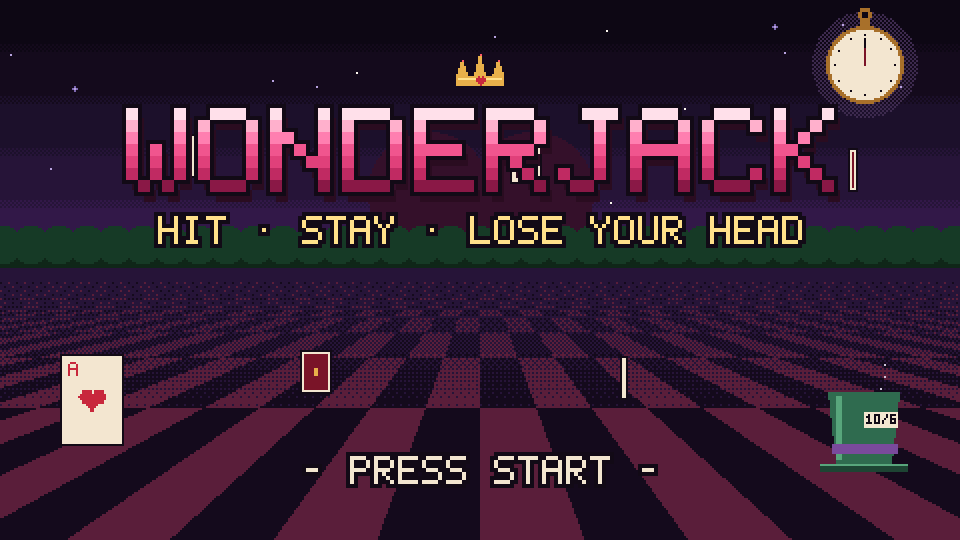

*Title screen mockup (it uses the working title "Wonderjack").*

A first-person, pixel-art blackjack battler: Alice sits at a card table across from Wonderland's card soldiers and bosses. This section explains how it looks and moves, and why.

### Design pillars

| Pillar | What it means | Why |
| --- | --- | --- |
| **Risk with partial control** | Two decks: a blind **hit deck** you can't control, and a **built deck** of cards you collect and choose from. | Pure blackjack is luck; pure deckbuilding removes tension. Half-random, half-chosen keeps every hit nerve-wracking but every loss feels fixable. |
| **Read the table** | Enemies telegraph surprise attacks with an intent bar and a visible tell. | Hidden attacks feel unfair; telegraphed ones turn into decisions ("hit now before she bonks me?"). |
| **Short, repeatable runs** | 10 to 20 second rounds, 5 fights per act, a fresh deck every run. | A loop you want to replay, not a story you finish once. |
| **Wonderland, our way** | Based on Lewis Carroll's book and the public-domain Tenniel illustrations, not any film adaptation. | Original designs we can own, and a stronger identity than a copy. |
| **Teach without lecturing** | A visible discard pile and bust odds build probability intuition. | Players learn card counting and risk by playing, which is the game's purpose. |

### Art direction

- **Pixel art at 480×270**, scaled up by whole numbers. Big enough for expressive faces, small enough that a three-person team can finish the art in a hackathon.
- **First-person POV at the table.** The enemy sits across from you, lit from below by one warm lamp; your hands and cards sit at the bottom of the screen. It feels personal and tense, like a real high-stakes game.
- **Moody palette with bright accents.** Deep purples and wine reds for rooms; Queen reds, card cream and lamp gold for anything you need to read quickly.
- **Every sprite has a 1-pixel dark outline**, so characters pop off busy backgrounds.

### The cast

Every character has an **idle** loop (left) and an **action** (right). The action is their surprise attack.

#### Alice (you)
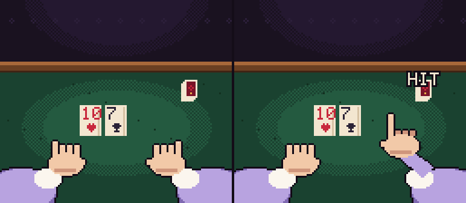

Only her hands and lavender sleeves are visible. **Why:** the hands are the player's body language. They drum while you think, tap to hit, wave off to stay, and pump a fist on 21. Lavender instead of the famous blue keeps her ours.

#### Card soldiers
| Spade: +1 to your total | Club: +2 to your total | Diamond: −5 off your total | Heart: removes your last card |
| --- | --- | --- | --- |
| 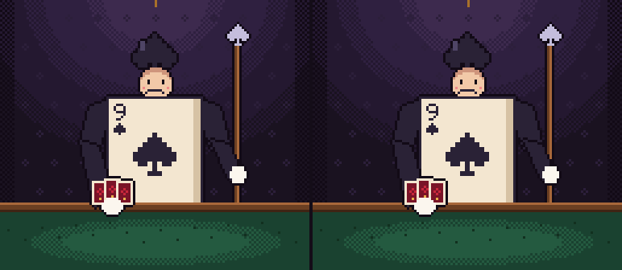 |  | 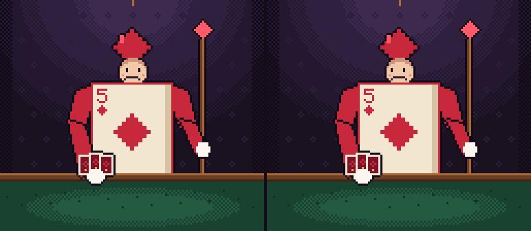 | 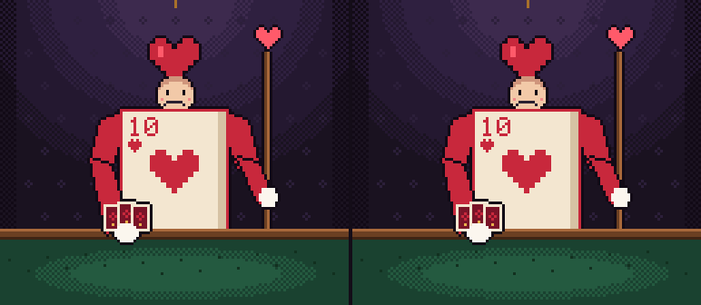 |

One shared body (a playing card with arms, a suit helmet and a halberd) with four attacks. (The GIFs are the original mockups; Dig and Pilfer now belong to the Queen.) **Why:** one base sprite recoloured four times saves art time, and each suit's attack teaches one mechanic before the boss combines them.

#### Cheshire Cat (Act 2 boss)
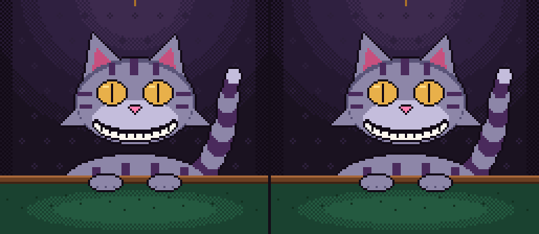

Fades until only his grin is left, and your total shows as `??`. **Why:** his attack is information denial, matching a cat famous for vanishing.

#### Knave of Hearts
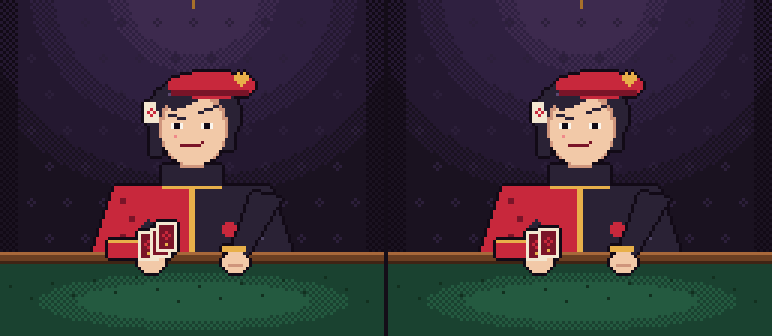

A card-sharp who steals from your hand and winks. **Why:** in the book he's the tart thief, so his move is theft.

#### Mad Hatter (Act 1 boss)
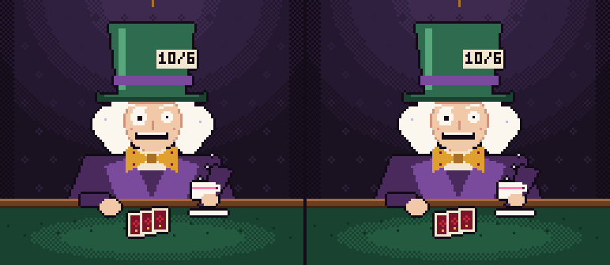

His "Move down!" swaps hands with you, straight from the tea party where everyone changes seats. The 10/6 hat tag comes from the book.

#### Queen of Hearts (final boss)
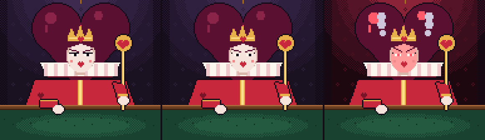

Idle, "Off with its head!", and enraged below 50% HP. Her heart-shaped hairdo is our own silhouette. She also learns every soldier's trick:

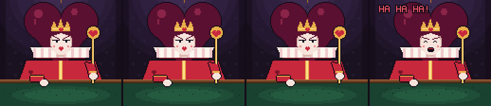

**Why:** the final boss tests everything the soldiers taught. She cycles her attacks in a fixed order, so players who pay attention can predict her.

### Battle backgrounds: one room per act

| Act 1: Tea Party | Act 2: Tulgey Wood | Act 3: Queen's Court |
| --- | --- | --- |
| 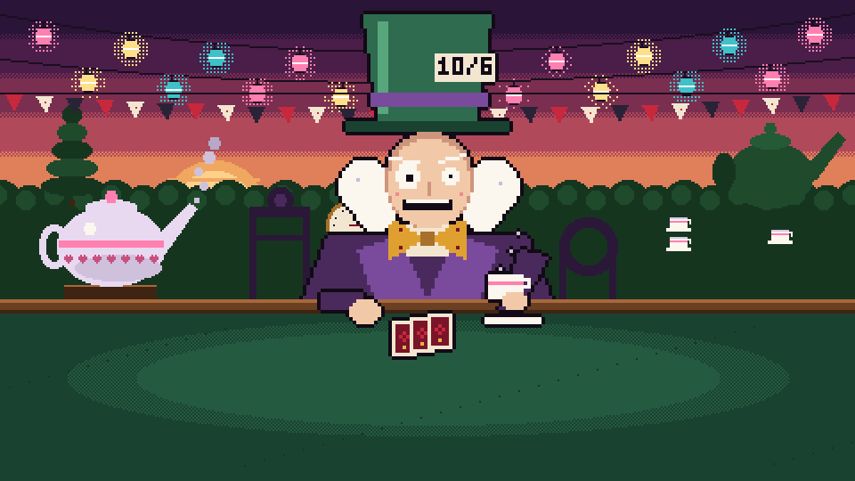 | 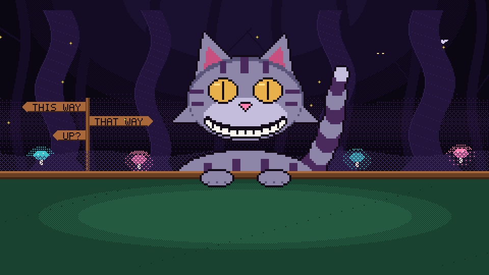 | 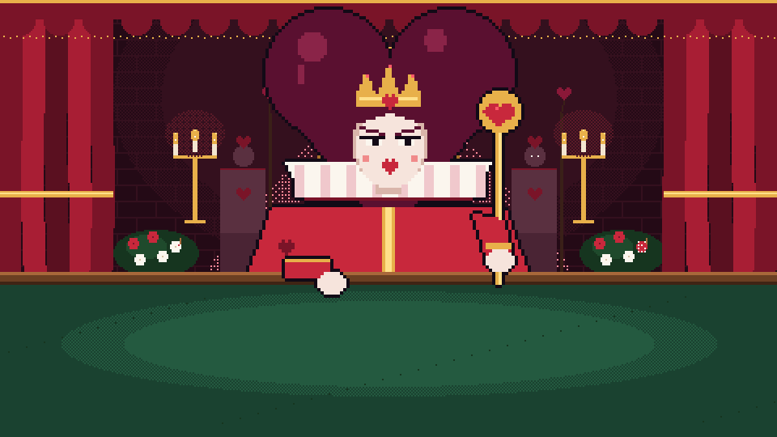 |
| Warm, silly sunset garden so new players relax. | Cold, crooked night forest: the creepiest act. | Rich reds and gold: the stakes are highest. |

**Why separate rooms:** each act's mood rises in tension, and players can tell at a glance how far they've come. Every room is split into moving layers (lanterns, fog, flames, curtains) so the engine can animate them separately.

#### The room reacts to the game
| Close to bust (18+) | Boss enraged (below 50% HP) |
| --- | --- |
| 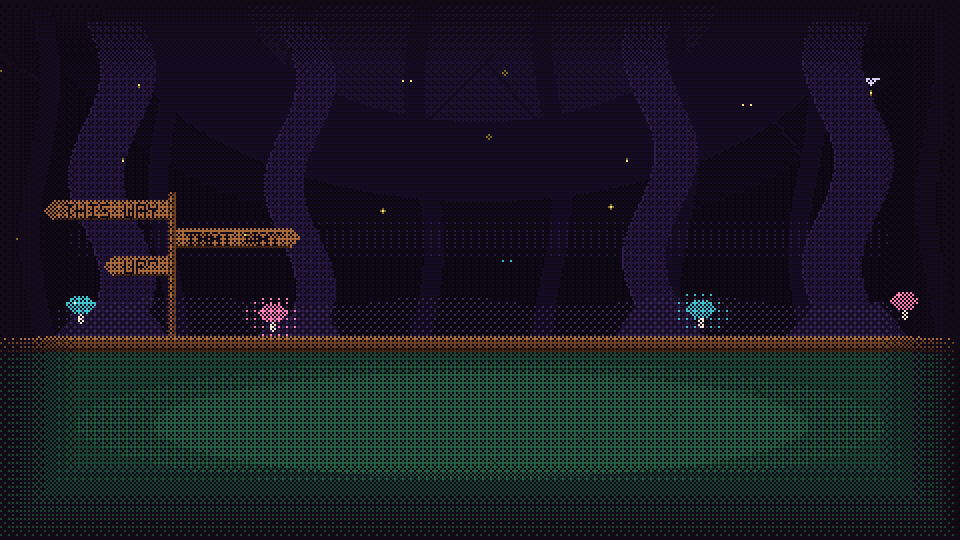 | 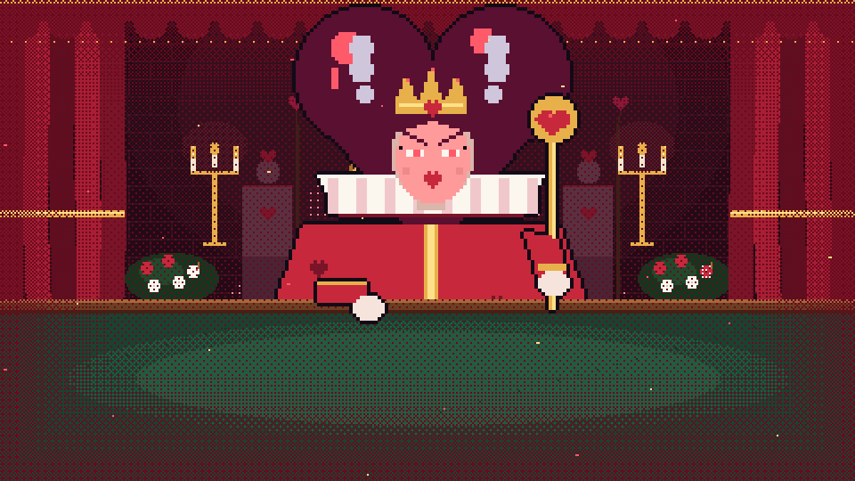 |

**Why:** the background tells you your danger level without reading a number. A heartbeat vignette means "careful"; a red room with embers means "she's angry".

### The battle screen

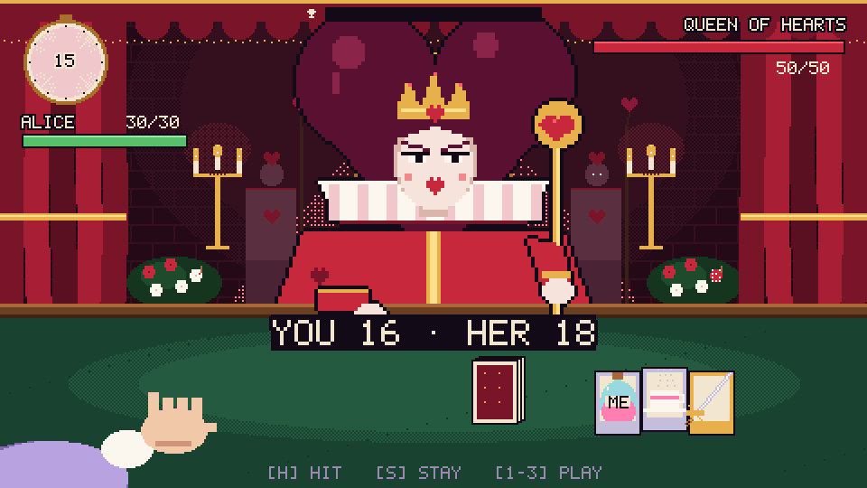

A 3-round demo: a hit and the Queen's +2 Bonk, then a **BUST!**, then a dealt **21** with a critical Vorpal slash.

| Element | Where | Why there |
| --- | --- | --- |
| Pocket-watch timer | Top left | A Wonderland object that is also the round clock. It flashes red for the last 3 seconds. |
| Your HP / enemy HP | Top left / top right | Mirrored, so you compare at a glance. |
| Intent bar | Above the enemy's head | Right where you're already looking; fills before a surprise attack. |
| Totals strip | Table edge | Between you and the enemy, the one number that matters most. |
| Your cards and deck | Bottom centre | On the table, like real blackjack. |
| Special cards | Bottom right | Your hand of choices, apart from the blind cards. |

### Special cards

| Drink Me | Eat Me | Teacup |
| --- | --- | --- |
| 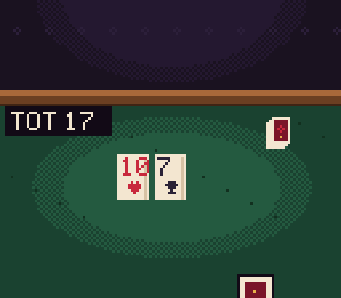 |  |  |
| Last card −3 | Last card +3 | Peek at the next card |

| Pocket Watch | Looking Glass | Vorpal Blade |
| --- | --- | --- |
|  |  |  |
| Freeze the timer | Copy the enemy's last card | This round counts as a critical |

Every special card shares one cutscene: rise from your hand, zoom, flip with a flash, play its effect. **Why:** one shared animation means a new card only needs new art, and the flip makes every play feel like an event.

### Enemy reactions: tell, hurt, defeat

| Soldier | Cheshire Cat | Knave |
| --- | --- | --- |
| 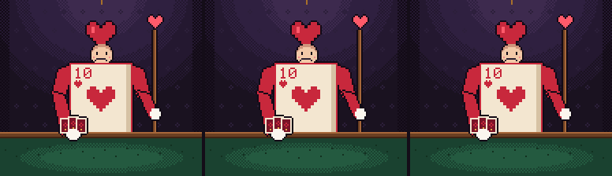 | 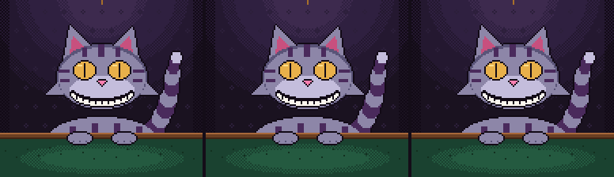 | 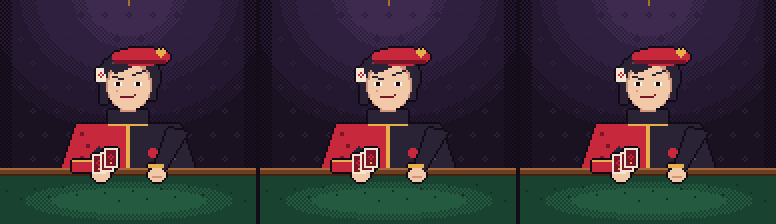 |

| Mad Hatter | Queen |
| --- | --- |
| 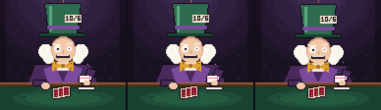 | 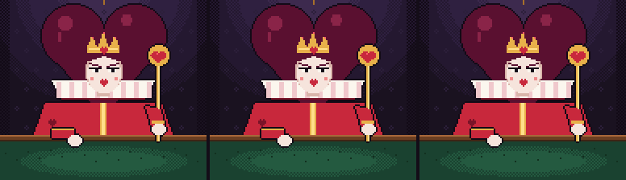 |

- **Tell:** a wind-up pose and a flashing `!`, giving skilled players a beat to react.
- **Hurt:** white flash, knockback and a damage number, so every hit feels earned.
- **Defeat:** unique to each character (the soldier folds into a burst of cards, the Cat goes POOF, the Knave gets dragged off, the Hatter falls asleep), so each victory is memorable.

### Endings

| Win: off with hers | Lose: off with yours |
| --- | --- |
|  | 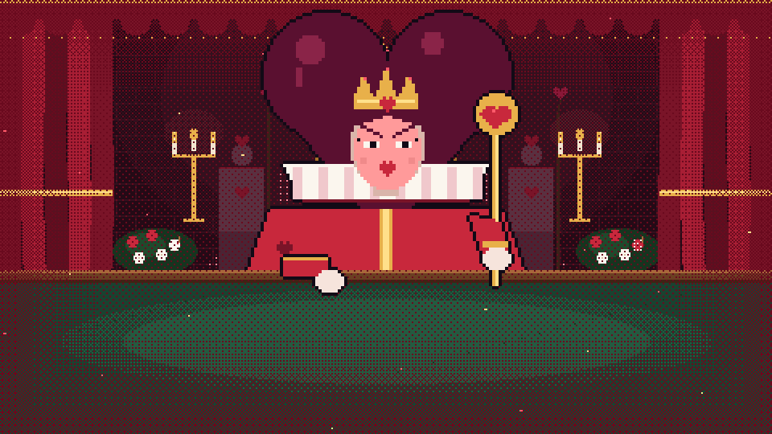 |

The run's payoff. **Win:** the world drains to grey, an axe shadow passes, and her head flips into a Queen card that lands on the table. **Lose:** the axe swings at the camera and your view drops to table level while she laughs. Both stay stylized (card flips, silhouettes, no blood), which is funnier and fits Wonderland's storybook tone.

### Transitions

| Between acts: down the rabbit hole | Between fights: card wipe |
| --- | --- |
| 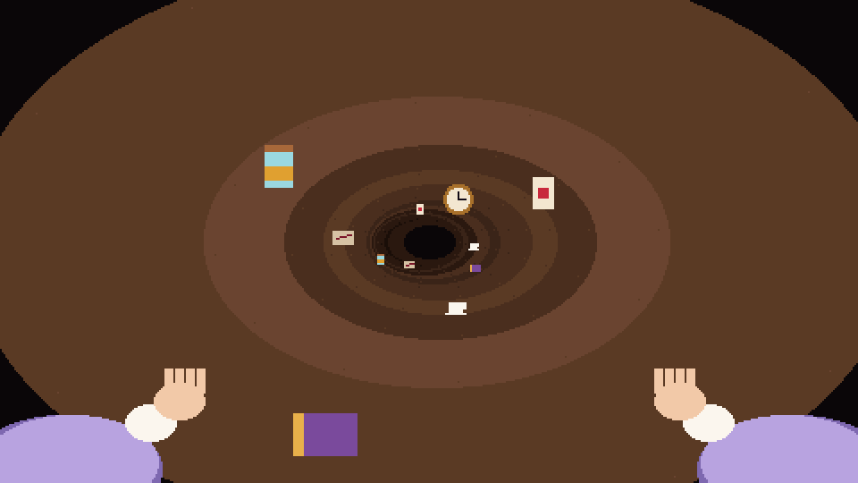 | 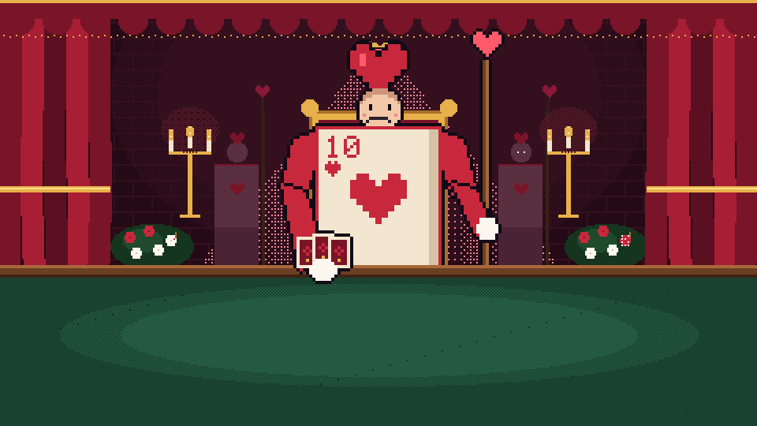 |

**Why:** falling down the rabbit hole is the most famous moment in the book, so it marks moving to a new act. The card wipe is quick and on-theme for fights within an act.


#### From design to game
The same drawing engine made these GIFs and the game's art. `tools/sprites` renders every animation above into sprite sheets in `game/art/anim/`, and the game plays them: the act's room, the enemy across the table, its tell and attacks, the Queen's rage and laugh, the pocket-watch timer, damage numbers, BUST and 21 banners, the Vorpal slash, special-card cutscenes, mood vignettes, the endings, the card-wipe between screens and the rabbit hole at the start of a run.

## Repo layout

```
/game     Godot 4 project (GDScript)
  /data   cards, enemies, acts, rules, trinkets JSON: the shared contract
/server   FastAPI backend (leaderboards, daily runs, run stats, card data)
```

## Shared data

`game/data/*.json` is the single source of truth. Design edits names, text and art paths. Game logic edits numbers and effects. The backend serves the same files. Review JSON changes in pull requests so nobody silently changes balance.

| File | What's in it |
| --- | --- |
| `cards.json` | Every card: `id, name, type, value, rarity, pool, effect, params, art, anim, text` |
| `enemies.json` | The four suit soldiers and the Queen: HP, attack, AI numbers, surprise attack |
| `acts.json` | Act 3, The Queen's Court: 4 shuffled soldiers, then the Queen |
| `rules.json` | Every tunable number: HP, timer, plays per round (0 = no limit), attack warning time, damage table, gold, rewards |
| `trinkets.json` | Passive items (stretch goal) |

## Run the API locally

```bash
cd server
python -m venv .venv && source .venv/bin/activate
pip install -r requirements-dev.txt
uvicorn app.main:app --reload      # http://localhost:8000/docs
python -m pytest                   # tests
```

Settings come from environment variables; see `server/.env.example`.

### API

| Method + path | Purpose |
| --- | --- |
| `GET /health` | Is the server up (the game shows online/offline) |
| `GET /daily-seed` | Today's shared seed `{date, seed}` |
| `GET /cards` | `cards.json` with an ETag (the game falls back to its bundled copy) |
| `POST /run` | Submit a finished run → `201 {id, rank}`; invalid → `422` |
| `GET /leaderboard?daily=&limit=` | Top runs: winners, then battles won, then time |
| `GET /stats` | Win rate, bust rate, blackjack rate, Queen kills, top cards |

Stretch extras: `DELETE /run/{id}` with an `X-Admin-Key` header, and `GET /board`, an auto-refreshing leaderboard page for a second screen.

**Anti-cheat basics.** Any run sent from a browser can be faked, so the server stops junk and casual cheating:
- It checks every range (battles 0–5, at least 30 s, busts ≤ rounds, `won` only with 5 battles).
- It cleans names and rate-limits `POST /run`.
- It rejects old game versions, and daily runs that don't use today's seed.

## Run the game

1. Install [Godot 4.7](https://godotengine.org/download) (standard build, not .NET).
2. Open `game/project.godot` and press **F5**. Any scene also runs on its own with **F6**.
3. Controls:
   - **H** hit, **Space** ready (or **S**), **E** heal, **1–5** play a hand card, **M** mute
   - debug builds only: **F1** overlay, **F2** instant win, **F3** print seed
4. The game talks to the API at `http://127.0.0.1:8000` by default. To point it elsewhere, run `godot --path game -- --api=https://...`, or edit `cardclash/api/base_url` in Project Settings. Offline, everything still works except the leaderboard and the daily run.

Unit tests use [GUT](https://github.com/bitwes/Gut). Install **GUT 9.7.1** from the Asset Library (it lands in `game/addons/gut`, which git ignores), then:

```bash
cd game
godot --headless --import
godot --headless -s addons/gut/gut_cmdln.gd -gdir=res://tests -gexit
godot --headless --fixed-fps 60 -- --autoplay    # a bot plays a whole run
```

CI does all of this on every pull request (`.github/workflows/game.yml`). `test_balance` also prints a balance report (rounds per fight, win and bust rates) to compare with the targets.

Placeholder art, fonts and sounds come from `python3 tools/export_art.py`. The designer's files replace them at the same paths.

## How the game is built

- **Logic never depends on art.**
  - `scripts/core` holds plain classes with no scene code: `Card`, `Rules`, `HitDeck`, `PlayerDeck`, `BattleState`.
  - `BattleController` drives them in real time (Timer nodes for the round, the AI tick and the intent bar) and re-emits every change on the `Events` bus.
  - The UI and `Audio` only listen.
- **All numbers live in `game/data`.** Balancing is editing JSON.
- **One seeded RNG** (`Rng`). Same seed, same run: needed for the daily run and bug reports.
- **Cards are data plus one small script.** `effect` names map to `scripts/effects/<name>.gd`, and enemy surprise attacks to `scripts/effects/enemy/<name>.gd`.
- **`Api`** is the only thing that touches the network. It fails silently, and scenes pass callbacks so leaving a screen mid-request is safe.
- **Art is exported, not hand-placed.** `tools/sprites` renders every sprite sheet into `game/art/anim/` with a `manifest.json`; `AnimLib` turns them into `SpriteFrames`. `battle_ui.gd` and `BattleFx` play the animations and effects in response to `Events`, and fall back to plain shapes if a sheet is missing. To change the art: edit `tools/sprites/engine.js`, run `npm run export` there, then `godot --headless --import` (see `tools/sprites/README.md`).
- **`Transition`** (autoload) does the card wipe between screens and the rabbit-hole fall at the start of a run; headless and autoplay runs switch scenes instantly.

## Deploy

**API → Render** (`render.yaml`):
1. In Render, choose **New → Blueprint** and pick this repo. You get the `cardclash-api` web service and a free Postgres database. On a free host SQLite can reset on redeploy, so Postgres is used here; locally it stays SQLite.
2. Set `ALLOWED_ORIGINS` to the game's origin. itch.io serves web games from `https://html-classic.itch.zone`.
3. Open `https://<service>.onrender.com/docs` to check it.

**Web build → itch.io:**
1. In Godot: **Project → Export → Web → Export Project** (this needs the 4.7.2 export templates).
   - The preset ships the data JSON and leaves out tests and GUT.
   - Threads are off, so itch.io needs no SharedArrayBuffer headers.
   - The web build calls `cardclash/api/base_url.web`. Change it if your Render URL differs.
2. Zip `game/build/web/` and upload it to itch.io as an HTML game.

**Desktop backup:** the **Windows Desktop** and **Linux** presets build a single-file game. Keep one on a USB stick.

### Demo-day checklist

- [ ] Open `/health` a few minutes before judging. Free servers sleep and take 30+ s to wake.
- [ ] Have a local backup server ready: `cd server && uvicorn app.main:app`, and run the game with `-- --api=http://127.0.0.1:8000`.
- [ ] Remember the game is fully playable offline: a dead Wi-Fi only costs the leaderboard.
- [ ] Put `GET /board` on a second screen as a live leaderboard.
- [ ] Use `DELETE /run/{id}` with `X-Admin-Key` to remove junk entries (the key is in Render's env vars).
